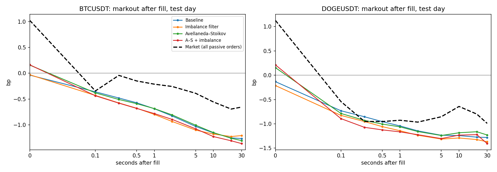
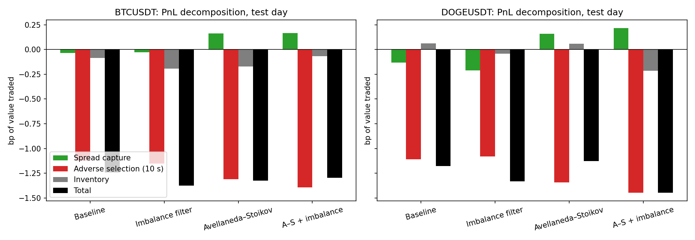
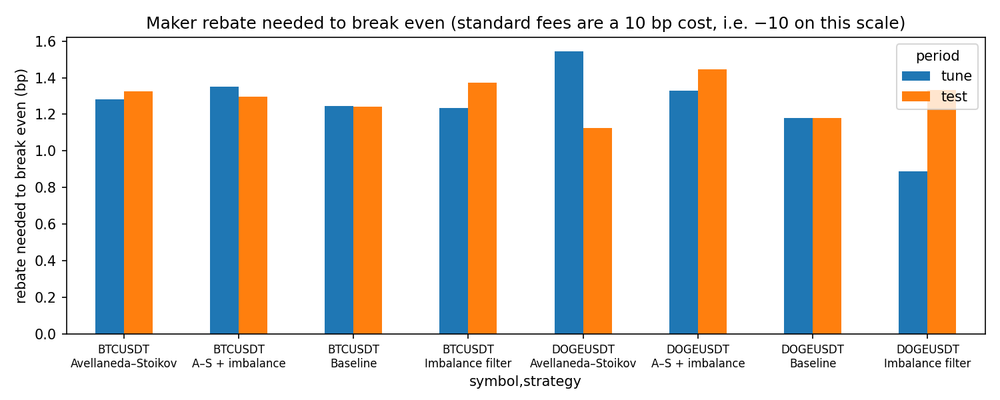

# Market Making on Real Order Book Data

**Can a passive market maker make money on Binance spot, and if not, why not?**

I built an order book recorder, an event-driven backtester that models latency and queue position, and four quoting strategies, then tested them on three full days of Binance BTCUSDT and DOGEUSDT data with a strict tune/test split.

## Key findings

1. **Order book imbalance predicts the next price move.** On BTCUSDT, the probability that the next mid-price move is up rises from 20% to 82% across imbalance buckets. Out of sample (trained on August and September, tested on October, sampled once per second), a logistic regression reaches 69.5% accuracy and AUC 0.76, against a 50% baseline.
2. **Quoting at the best bid and ask loses about 1.2 bp of value traded, on both pairs, before fees.** BTCUSDT: −1.25 bp on the tuning days, −1.24 bp on the test day. DOGEUSDT: −1.18 bp on both. A maker rebate of about 1.2 bp would be needed to break even; standard fees are a cost of 10 bp.
3. **Adverse selection is the cause.** Splitting PnL into spread capture, adverse selection and inventory, adverse selection accounts for almost all of the loss: −1.12 bp (BTC) and −1.11 bp (DOGE) for the baseline on the test day, while spread capture and inventory are each within ±0.2 bp. A larger tick does not rescue the baseline: on DOGE, where one tick is about 1.06 bp (against 0.001 bp for BTC), value-weighted spread capture is still slightly negative (−0.13 bp). The simple per-fill average is slightly positive, so the larger fills are the worse ones, most likely full fills when the price moves through the quote. Quoting further away (Avellaneda–Stoikov) makes spread capture positive (+0.16 bp), but adverse selection grows by about as much.
4. **None of the strategies fixed this out of sample.** An imbalance filter, Avellaneda–Stoikov inventory quoting, and both combined all landed between −1.13 and −1.45 bp on the test day. The best tuning-day result (DOGE imbalance filter, −0.89 bp) did not hold on the test day (−1.33 bp).
5. **Lower latency did not help.** Cutting latency from 200 ms to 5 ms changed BTCUSDT from −1.24 to −1.34 bp: the problem is which fills you get, not how fast you are. (Limitation below: the data cannot capture sub-100 ms queue races.)
6. **The simulator behaves like the real market, and the gap is informative.** Measuring the passive side of every real trade the same way, the price also moves against real passive orders after they fill. On the test day, real passive orders end at −0.56 bp (BTC) and −0.64 bp (DOGE) after 10 s, against −1.16 and −1.24 bp for the baseline. The ~0.6 bp gap comes mostly from the moment of the fill: real passive orders include fast traders at the front of the queue and orders deeper in the book that fill at better prices. It is a measure of the cost of being slow and at the back of the queue.





## Data

- Source: [Tardis.dev](https://tardis.dev) free historical data (first day of each month), Binance spot: full order book updates and every trade.
- Days: 2026-08-01 and 2026-09-01 (tuning), 2026-10-01 (test).
- I also built my own recorder (`record.py`) on Binance's live feed and validated it: 0 sequence gaps and 0 crossed books after rebuilding. Tardis data was used for the study to cover more days and market conditions.
- Raw data is not included in this repository; the scripts below download and rebuild it.

## Method

**Order book rebuild.** Snapshots plus incremental updates are applied in sequence, with gap detection and resynchronisation. Validity check: the book is never crossed.

**Backtester** (`backtester.py`). Replays book updates and trades in exchange-time order and simulates my own orders:
- latency: an order or cancel decided at time t takes effect at t + 200 ms
- queue position: orders join the back of the displayed queue; trades at that price fill the orders ahead first; cancellations by others are modelled as either all behind (pessimistic) or spread evenly (proportional)
- post-only rejection, partial fills, and fills when trades or the book move through the order's price
- fees applied afterwards, so one run gives PnL at every fee level

The fill logic is covered by unit tests (`test_backtester.py`, `test_strategies.py`).

**Strategies** (`strategies.py`):
- baseline: join the best bid and ask, with an inventory limit
- imbalance filter: withdraw the side that best-level imbalance says is about to be run over
- Avellaneda–Stoikov: quotes around an inventory-adjusted reservation price, with live volatility
- Avellaneda–Stoikov combined with the imbalance filter

**Avoiding overfitting.** Parameters were chosen on the tuning days only, ranked by PnL per value traded (ranking by total PnL would just reward trading less), with a minimum volume requirement. The chosen settings were then run once on the test day.

**Evaluation.** PnL is split into spread capture (side × (mid at fill − fill price)), adverse selection (side × (mid 10 s later − mid at fill)) and inventory (the rest). These add up exactly to gross PnL.

## Results

Gross PnL before fees, in bp of value traded. Parameters chosen on the tuning days; the test day was used once.

| Pair | Strategy | Tuning days | Test day | Test: spread capture | Test: adverse selection (10 s) | Test: inventory |
|---|---|---|---|---|---|---|
| BTCUSDT | Baseline | −1.25 | −1.24 | −0.04 | −1.12 | −0.09 |
| BTCUSDT | Imbalance filter (θ = 0.8) | −1.24 | −1.37 | −0.03 | −1.15 | −0.19 |
| BTCUSDT | Avellaneda–Stoikov (γ = 0.005) | −1.28 | −1.32 | +0.16 | −1.31 | −0.17 |
| BTCUSDT | A–S + imbalance | −1.35 | −1.30 | +0.17 | −1.39 | −0.07 |
| DOGEUSDT | Baseline | −1.18 | −1.18 | −0.13 | −1.11 | +0.06 |
| DOGEUSDT | Imbalance filter (θ = 0.6) | −0.89 | −1.33 | −0.21 | −1.08 | −0.04 |
| DOGEUSDT | Avellaneda–Stoikov (γ = 0.0001) | −1.54 | −1.13 | +0.16 | −1.34 | +0.06 |
| DOGEUSDT | A–S + imbalance | −1.33 | −1.45 | +0.22 | −1.45 | −0.22 |

The break-even maker rebate equals minus the gross figure (for example 1.24 bp for the BTCUSDT baseline on the test day).



## Limitations

- **100 ms book snapshots.** Queue races within 100 ms, which is where the fastest firms gain, cannot be simulated. A 5 ms latency run is therefore only approximate.
- **No market impact.** Orders are assumed small enough not to change other traders' behaviour.
- **Queue position is estimated** from displayed sizes, not from individual orders.
- **One exchange, two pairs, three days.** Results may differ in other markets and conditions.
- **Markouts assume the position is held.** Real market makers usually hedge or trade out sooner.

## What I would do next

- Use order-by-order (MBO) data, for example Nasdaq equities through Databento, to model exact queue position.
- Add hedging and faster inventory exits, then compare against the 10-second markout.
- Calibrate Avellaneda–Stoikov's k from observed fill rates instead of setting it by hand.
- Test UK equities, where the MiFID II tick-size regime gives different tick-to-volatility ratios across stocks.

## Reproduce

```
pip install -r requirements.txt
python download_tardis.py
python download_tardis.py --symbol DOGEUSDT
python rebuild_tardis.py
python rebuild_tardis.py --symbol DOGEUSDT --out data/processed_doge
python -m pytest -q
python run_experiments.py
python run_experiments.py --data data/processed_doge --tick 0.00001 --order-size 500 --max-position 5000
python run_final.py
python check_market_markout.py
python check_market_markout.py --data data/processed_doge --tick 0.00001
```

Then run the notebooks in order: `01_explore.ipynb`, `02_imbalance_signal.ipynb`, `03_evaluation.ipynb`. All results are deterministic.

| File | Purpose |
|---|---|
| `record.py`, `rebuild_book.py` | Live recorder and book rebuild for Binance |
| `download_tardis.py`, `rebuild_tardis.py` | Historical data download and book rebuild |
| `backtester.py` | Event-driven backtester |
| `strategies.py` | Quoting strategies |
| `run_backtest.py` | Run one strategy |
| `run_experiments.py` | Tune/test comparison |
| `run_final.py` | Final runs for the evaluation |
| `check_market_markout.py` | Validation against all real passive orders |
| `01`–`03` notebooks | Exploration, imbalance signal, evaluation |
